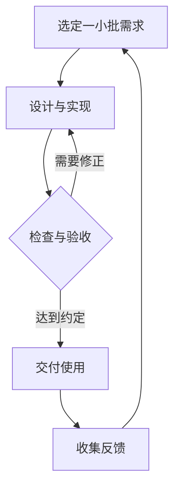

# 软件工程流程

**软件工程流程，就是把一个软件从“想做什么”，逐步推进到“设计出来、实现出来、验证合格、交给用户使用，并持续维护”的完整过程。**

可以先记住这条主线：

**问题定义与计划 → 需求分析 → 概要设计 → 详细设计 → 编码实现 → 测试与验收 → 部署交付 → 运行维护。**

这是便于学习的一种划分。实际项目会根据规模合并或细分这些环节，很多工作也会交叉进行。软件工程涉及的主要领域包括需求、架构与设计、软件构建、测试、运行维护，以及贯穿其中的管理活动。[参考资料 1][1]

下面先看整体，再用一个小项目把它串起来。

## 一、每个阶段究竟在解决什么问题？

| 阶段 | 核心问题 | 主要成果 |
|---|---|---|
| **问题定义与计划** | 给谁解决什么问题？现有时间、技术和资源能否完成？ | 项目目标、范围、计划 |
| **需求分析** | 软件要有什么功能？达到什么程度算合格？ | 需求清单、优先级、验收标准 |
| **概要设计** | 整个软件分成哪些部分？各部分怎么配合？ | 系统结构、模块划分、主要接口 |
| **详细设计** | 每个模块内部具体怎么实现？ | 数据结构、算法、接口和异常处理方案 |
| **编码实现** | 怎样把设计变成可运行的程序？ | 源代码、构建配置、可运行版本 |
| **测试与验收** | 功能是否正确？是否满足约定的使用要求？ | 测试结果、缺陷记录、验收结论 |
| **部署交付** | 用户怎样获得、安装和使用软件？ | 正式版本、部署和使用说明 |
| **运行维护** | 使用过程中出了什么问题？以后怎样改进？ | 修复版本、运行反馈、后续需求 |

理解流程时，要抓住一个联系：

**需求给设计提供目标，设计给编码提供方案，需求和设计又给测试提供判断依据。**

如果前面没有说清楚“做到什么程度算完成”，后面就很容易出现：开发者觉得已经做完，用户却觉得根本没达到要求。

## 二、用“作业记录器”走一遍完整流程

假设准备开发一个小软件，用来记录课程作业、截止时间和完成情况。

### 1. 问题定义与计划：先确定目标和范围

最初的想法可能只有一句：

> 我想做一个记录作业的软件。

这时需要把它具体化：

- **使用者是谁？** 先给自己使用。
- **解决什么问题？** 作业分散在不同地方，容易忘记截止时间。
- **第一版要做到什么？** 能录入作业、查看列表、标记完成，并保存记录。
- **有什么限制？** 自己独立开发，时间和技术能力有限。
- **优先验证什么？** 先确认记录、保存和再次读取能完整跑通。

这一阶段还要考虑可行性，例如：现有技术能否实现，时间是否够用，是否依赖暂时拿不到的设备或服务。

**阶段成果可以很简单：一段目标说明，加上一份首版功能清单和时间安排。**

个人小项目也需要范围。否则做到一半，突然增加账号、云同步、消息推送、统计图表，原来的工作量和完成时间都会变化。

### 2. 需求分析：把“想要”变成可以检查的要求

这里要把功能、规则和质量要求写清楚。

比如，作业记录器的功能需求可以是：

1. 用户可以输入作业名称和截止时间。
2. 软件可以显示已保存的作业。
3. 用户可以把作业标记为完成。
4. 关闭并重新打开软件后，记录和完成状态仍然存在。

还要进一步明确规则：

- 名称为空时怎么处理？
- 截止时间输入不合法时怎么处理？
- 标记完成后，是否允许恢复为未完成？
- 保存失败时，界面应该显示什么？

这些细节会直接影响实现和测试。

需求还包括质量要求，例如响应速度、兼容性、可靠性和易用性。像“响应要快”这样的说法比较模糊；如果要写成“列表打开时间不超过一秒”，还需要说明测试设备、记录数量和测量场景。

**这一阶段就应该考虑验收标准。**例如：

> 添加三条作业，把其中一条标记为完成，关闭软件后重新打开。三条记录都应存在，完成状态应与关闭前一致。

这句话同时说明了操作步骤和预期结果，后面可以直接据此检查软件。

需要分清：

| 表述 | 主要属于 |
|---|---|
| 重新打开软件后，作业记录仍然存在 | 需求：规定应有的行为 |
| 使用某种文件格式或数据库保存作业 | 设计：选择实现方式 |

需求中也可能包含技术约束，例如课程明确要求使用某种语言。区分需求与设计时，重点看它是在**约定目标和限制**，还是在**选择实现方案**。

### 3. 概要设计：确定软件的整体结构

需求明确之后，就要决定软件由哪些部分组成。

这个小项目可以划分为三个模块：

| 模块 | 职责 |
|---|---|
| 界面模块 | 接收用户输入、显示作业列表、提供操作入口 |
| 业务模块 | 检查输入、创建作业、修改完成状态 |
| 存储模块 | 保存作业、读取作业、报告存储错误 |

接下来，要约定模块之间怎样配合。

例如，用户点击“添加”之后：

**界面提交输入 → 业务模块检查数据 → 存储模块保存 → 界面根据结果更新显示。**

概要设计主要关心：

- 哪个模块负责哪件事？
- 数据经过哪些部分？
- 模块之间传递什么信息？
- 某一部分失败后，其他部分怎样知道？

**模块可以只是同一个程序中的不同文件、类或函数集合。**划分的意义在于明确职责，让后续实现和修改有清楚的边界。

### 4. 详细设计：明确每个模块内部怎么工作

概要设计确定了整体结构，详细设计继续落实到内部规则。

以“添加作业”为例，需要决定：

- 一条作业保存哪些字段？
- 怎样区分两条同名作业？
- 日期采用什么表示方式？
- 名称允许多长？
- 保存失败时返回什么结果？
- 什么时候向用户显示“添加成功”？

可以为一条作业设计这些字段：

| 字段 | 用途 |
|---|---|
| `id` | 唯一标识这条作业 |
| `title` | 作业名称 |
| `deadline` | 截止时间 |
| `completed` | 是否完成 |

“添加作业”的内部处理过程可以约定为：

1. 读取名称和截止时间。
2. 检查输入是否合法。
3. 为新作业分配唯一标识。
4. 尝试保存。
5. 保存成功后更新列表。
6. 保存失败时提示原因，并保留用户已输入的内容。

这里有一个很具体的工程判断：**显示“保存成功”的时机，应该与真正保存成功的结果对应。**

如果程序只是把内容画到了界面上，实际保存却失败了，用户会误以为数据已经留下来。这类问题就需要在设计和实现时考虑清楚。

对小项目，概要设计和详细设计可以写在一起；关键是把会影响正确性的规则想清楚。

### 5. 编码实现：按约定完成一个可运行的功能

接下来把设计写成代码，同时完成必要的检查、调试和集成。

对于这个项目，一个便于验证的实现顺序是：

1. 实现作业数据的保存与读取。
2. 实现添加作业的业务规则。
3. 接上界面，完成一次“输入—保存—显示”。
4. 加入完成状态修改。
5. 补齐已经约定的异常处理。

这样较早就能得到一条完整、可运行的使用路径，后续功能可以在这条路径上继续扩展。

开发过程中还需要管理代码版本。版本控制能够记录修改历史，支持检查差异和恢复旧版本；Microsoft 的开发流程说明也将代码编写、测试、评审、集成和版本控制放在开发活动中。[参考资料 2][2]

对个人项目，建议每完成一个能够独立说明、且已做基本验证的小改动，就留下一个清楚的版本记录。例如：

- 完成作业保存与读取。
- 完成作业状态修改。
- 修复空名称被保存的问题。

这样的记录有助于定位“哪次修改引入了问题”。

### 6. 测试与验收：根据事先约定检查结果

测试可以从不同范围展开。入门时可以先这样理解：

| 测试层次 | 检查什么 | 作业记录器中的例子 |
|---|---|---|
| **单元测试** | 一个较小的代码单元是否正确 | 名称校验函数是否拒绝空名称 |
| **集成测试** | 模块或系统之间是否正确配合 | 添加模块交给存储模块的数据是否正确保存 |
| **系统测试** | 完整软件的行为是否符合要求 | 能否完成添加、查看、修改和重新打开 |
| **验收测试** | 是否满足约定的使用需求和接受条件 | 按事先约定的场景验证，判断是否可以接受交付 |

集成测试还可以进一步区分组件间集成和系统间集成；验收测试关注使用需求及交付准备情况。[参考资料 3][3]

对于这个例子，至少应该覆盖：

- **正常情况：** 输入合法名称和日期，可以成功添加。
- **边界情况：** 没有任何作业时，列表仍能正常显示。
- **异常情况：** 输入不合法时，提示明确且不会保存错误数据。
- **数据一致性：** 修改状态并重新打开后，状态保持正确。
- **失败处理：** 保存失败时，界面能够如实告知。

还要区分两个相关的工作：

**测试提供检查结果和质量证据；验收根据事先约定，决定是否接受交付物。**验收测试本身也是测试的一种。

另外，表格把测试列在编码后面，是为了方便理解整体顺序。实际做项目时，需求阶段就可以编写验收场景，设计阶段就可以检查接口，开发一个模块时也可以立即测试它。

### 7. 部署交付：让用户在目标环境中使用

软件在开发者电脑上运行成功之后，还要处理交付环境的问题。

如果这是一个本地程序，需要考虑：

- 用户怎样安装或启动？
- 需要哪些运行环境？
- 数据存在哪里？
- 换一台目标电脑后能否运行？
- 用户遇到问题时，怎样提供有用的信息？

如果做成网站，则需要把程序放到目标运行环境，并检查用户能否通过实际地址访问和完成操作。

交付物通常包括：

**可运行的软件版本、必要的配置、启动或部署说明、使用说明，以及已知限制。**

一个很实用的检查方式是：按照交付说明，在干净的目标环境里走一遍启动和核心功能，确认说明与实际软件一致。

### 8. 运行维护：根据实际使用继续修正

交付之后，会出现开发阶段没有充分暴露的问题。

比如：

- 某台电脑上的日期显示异常。
- 作业多了之后，列表变慢。
- 用户经常需要找“本周到期”的作业。
- 修改保存格式后，旧记录需要继续读取。

这些问题会进入后续工作：

**记录问题 → 判断影响和优先级 → 分析原因或明确新需求 → 修改设计与代码 → 验证 → 发布新版本。**

运行工作也包括观察软件状态、定位故障和处理问题，这些是软件交付后的持续活动。[参考资料 4][4]

## 三、实际开发为什么会反复走这些步骤？

因为第一次分析和设计时，信息往往还不完整。实际使用、测试结果和技术验证都会带来新的认识。

一个小项目可以按下面的方式循环推进：

如果检查发现需求本身理解错了，也要回到需求分析，而不只是修改代码。

以后会听到“瀑布”“迭代”“敏捷”等术语：

- **瀑布式组织：** 比较强调按阶段整体推进，先完成一阶段的主要工作，再进入下一阶段。
- **迭代、增量式组织：** 先完成一部分有用的功能，经过检查和反馈，再逐轮扩充或改善。
- **敏捷：** 强调较短周期的可用软件交付、用户协作、反馈和适应变化，同时重视良好的设计与技术质量。[参考资料 2][2] [参考资料 5][5]

对于前面的作业记录器，可以这样安排：

| 版本 | 本轮完成的使用能力 |
|---|---|
| 第一版 | 添加、查看、保存作业 |
| 第二版 | 标记完成，并保存状态 |
| 第三版 | 按截止时间排序、筛选未完成作业 |
| 后续版本 | 根据使用反馈决定是否加入提醒等功能 |

**每一版都应该有明确的目标，并完成相应的设计、实现和验证。**

## 四、自己做小项目，最少应该留下什么？

初学者可以先保留下面五样东西，让流程真正落到项目里：

| 内容 | 最低限度写什么 |
|---|---|
| **需求与验收清单** | 首版做哪些功能，每个功能怎样判断完成 |
| **简单设计说明** | 模块职责、关键数据、主要接口和异常规则 |
| **代码版本记录** | 每次改了什么，哪些版本已经验证可用 |
| **关键测试记录** | 检查了哪些场景，结果怎样，还有什么问题 |
| **运行与使用说明** | 怎样启动，依赖什么，核心功能怎样操作 |

下一次准备写一个功能时，可以先回答这四个问题：

1. **这个功能要解决什么具体问题？**
2. **输入是什么，预期输出或状态变化是什么？**
3. **输入不合法或执行失败时，应该怎样处理？**
4. **准备用什么操作或测试，证明它已经做好？**

以“标记作业完成”为例，回答完这四个问题，就能把任务落实成：根据作业标识修改状态、保存结果、更新界面，并检查重新打开后状态是否保持。这样，需求、设计、编码和测试就在同一个具体功能上接起来了。

## 参考资料

1. IEEE Computer Society：[SWEBOK — Software Engineering Topics][1]。软件工程知识领域的概览。
2. Microsoft Learn：[What is DevOps?][2]。开发、交付、运行及持续改进等活动的说明。
3. ISTQB：[Certified Tester Foundation Level Syllabus，v4.0.1（PDF）][3]。测试层次、测试活动与验收测试的相关说明。
4. Microsoft Learn：[Operating reliable systems with DevOps][4]。软件运行、监控和可靠性相关实践的说明。
5. 敏捷宣言：[敏捷宣言遵循的原则][5]。关于持续交付、反馈、适应变化和技术质量的原则。

[1]: https://www.computer.org/education/bodies-of-knowledge/software-engineering/topics
[2]: https://learn.microsoft.com/en-us/devops/what-is-devops
[3]: https://www.istqb.org/wp-content/uploads/2024/11/ISTQB_CTFL_Syllabus_v4.0.1.pdf
[4]: https://learn.microsoft.com/en-us/devops/operate/operating-reliable-systems-with-devops
[5]: https://agilemanifesto.org/iso/zhchs/principles.html
